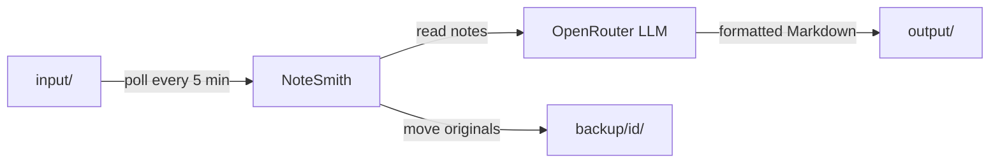

# NoteSmith

Automatically turn rough notes in your GitHub-hosted Obsidian vault into clean, well-structured Markdown using AI.

Drop raw `.md` or `.canvas` files into an `input/` folder of your vault repository. NoteSmith picks them up, reformats them with an LLM (via OpenRouter), writes the result to `output/`, and archives the originals.

## Features

- Polls your GitHub repository every 5 minutes; no local vault access needed.
- Reformats notes with Obsidian-native syntax: callouts, `==highlights==`, tables, headings, checklists.
- Converts `.canvas` files into regular `.md` notes.
- Preserves your subfolder structure (`input/Math/Algebra.md` becomes `output/Math/Algebra.md`).
- Backs up every processed original under a unique ID, so nothing is lost.
- Skips files ending with `_ignore.md`.

## How it works



Vault layout (`FOLDER` defaults to `AI_Formatter`):

```text
AI_Formatter/
├── input/    # put raw notes here
├── output/   # formatted notes appear here
└── backup/   # originals, grouped by run ID
```

## Requirements

- [Dart SDK](https://dart.dev/get-dart) 3.13.4 or newer
- A GitHub repository containing your vault
- A GitHub personal access token with **Contents: Read and write** permission
- An [OpenRouter](https://openrouter.ai) API key

## Installation

```bash
git clone https://github.com/<your-username>/notesmith.git
cd notesmith
dart pub get
cp .env.example .env
```

## Configuration

Edit `.env`:

| Variable         | Required | Default        | Description                                   |
| ---------------- | -------- | -------------- | --------------------------------------------- |
| `TOKEN`          | Yes      | -              | GitHub personal access token                  |
| `OWNER`          | Yes      | -              | Owner of the vault repository                 |
| `REPO`           | Yes      | -              | Vault repository name                         |
| `OPENROUTER_KEY` | Yes      | -              | OpenRouter API key                            |
| `BRANCH`         | No       | `main`         | Branch to read from and write to              |
| `FOLDER`         | No       | `AI_Formatter` | Root folder containing `input/` and `output/` |

## Usage

```bash
dart run bin/notesmith.dart
```

1. Push a note to `AI_Formatter/input/` in your vault repository.
2. Wait for the next polling cycle (up to 5 minutes).
3. Pull your vault; the formatted note is in `AI_Formatter/output/`.

To keep a file from being processed, name it `something_ignore.md`.

## Customization

- **Formatting style and language:** edit the prompt in [lib/system_prompt.dart](lib/system_prompt.dart).
- **Model:** change the `model` value in [bin/notesmith.dart](bin/notesmith.dart) (default `google/gemini-3.1-flash-lite`).
- **Polling interval:** change the `Future.delayed` duration in `startInfiniteLoop`.

## Running in the background

For continuous operation, run it on a server or Raspberry Pi, for example with `systemd`, Docker, or `tmux`.

Compile to a standalone binary:

```bash
dart compile exe bin/notesmith.dart -o notesmith
./notesmith   # run from the directory that contains .env
```

## Security notes

- Never commit `.env`; it is already listed in `.gitignore`.
- Use a fine-grained GitHub token limited to the vault repository.
- Note contents are sent to the LLM provider via OpenRouter. Do not process notes containing secrets.

## Troubleshooting

| Problem                                   | Fix                                                                             |
| ----------------------------------------- | ------------------------------------------------------------------------------- |
| `Missing required environment variables`  | Check that `.env` exists and `TOKEN`, `OWNER`, `REPO`, `OPENROUTER_KEY` are set |
| `no files to process skipping` repeatedly | Verify files are in `<FOLDER>/input/` on the configured `BRANCH`                |
| Output file not created                   | Check token permissions and whether the output file already exists              |

## License

Released under the [MIT License](LICENSE).
